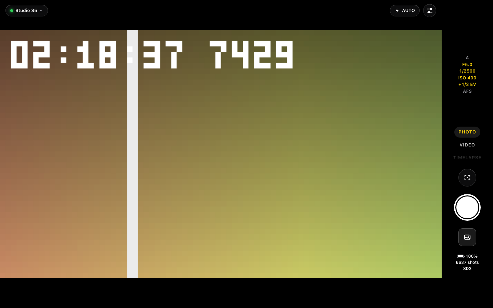
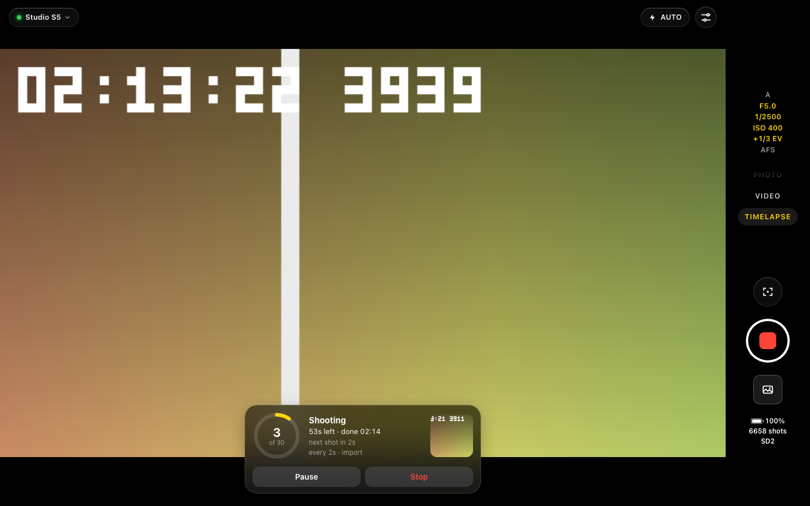
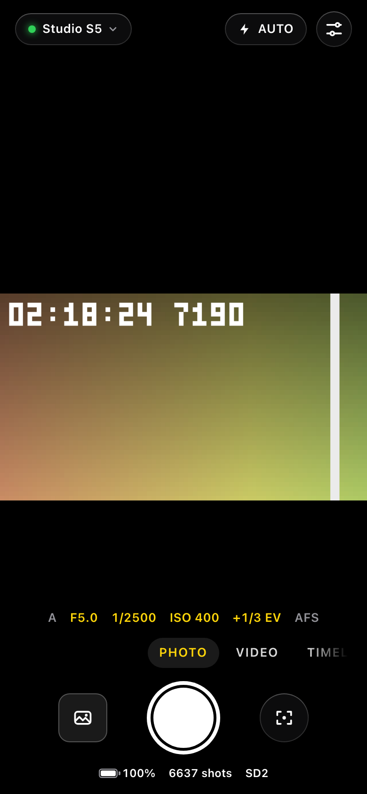

# LUMIX Remote: open-source Panasonic LUMIX camera remote for Mac (web app + CLI)

**Control a Panasonic LUMIX camera from your Mac, phone or terminal over Wi-Fi
and Bluetooth LE: live view, shutter, video, touch focus, every remote setting,
timelapse, and file transfer/import.** An open-source LUMIX Sync alternative
for desktop, built and verified on the **LUMIX S5 (DC-S5)**.

[](LICENSE)
[](https://www.python.org/)




LUMIX Remote is a small Python server that speaks the camera's Wi-Fi protocol
(the same `cam.cgi` / UPnP protocol LUMIX Sync and the old Image App use) and
serves a browser UI styled after the iPhone Camera app, plus a `lumix` command
line client and a JSON/WebSocket API. Use it for Lumix S5 Wi-Fi tethering on a
Mac, long timelapses with automatic import, pulling photos and videos off the
card without a cable, or scripting the camera from a terminal.

The protocol is reverse-engineered (see [docs/protocol-research.md](docs/protocol-research.md)).
Panasonic publishes no spec, so this is unofficial and may break with firmware updates.

## Features

- **Live view** in the browser (MJPEG + WebSocket), tap to focus, one-shot AF, power zoom.
- **Remote shutter and video** recording, with remaining shots, battery and card status.
- **Exposure controls**: aperture, shutter, ISO, EV, white balance, mode, focus, AF area, drive, quality.
- **Every remote setting** the body exposes, generated from the camera's own menu and searchable.
- **One-tap Auto preset** that saves your manual settings and restores them on the second tap.
- **Timelapse / intervalometer**: server-driven or the camera's own interval mode, with AE lock,
  pause/resume, survive-a-restart, automatic import and MP4 assembly (ffmpeg).
- **File transfer and import**: browse the card in an iOS-Photos-style grid, preview, download,
  and import to `~/Pictures/Lumix/<date>/` with RAW+JPEG pairs, resumable transfers and skip-duplicates.
- **Multi-camera**: several bodies at once, each with its own session, live view port and settings.
- **Guided onboarding** with the exact camera menu paths and a live connection tracker.
- **Bluetooth LE (experimental)**: register the Mac, sync the clock, ask the camera to join your Wi-Fi.
- **`lumix` CLI** for scripts and shell completion; **HTTP + WebSocket API** for everything the UI does.
- **Phone friendly**: add it to the iPhone home screen and it runs full screen (PWA).
- **Camera emulator** so contributors can develop and test without a camera.
- Graceful power-off/server-stop handling: imports are checkpointed, recordings stopped, timelapses paused and resumed.

| Timelapse running | On a phone |
|---|---|
|  |  |

(Screenshots are from the bundled camera emulator, whose live view is a synthetic test pattern.)

## Supported cameras

| Camera | Status |
|---|---|
| Panasonic LUMIX **DC-S5** (firmware 2.03) | Verified on a real body: Wi-Fi control, live view, files, timelapse, BLE registration |
| Other LUMIX bodies that support LUMIX Sync / Image App remote shooting (S5II, S1, GH5, GH6, G9, G9II, ...) | Untested; they run on the `generic` profile and may work. Reports and profiles welcome |

Everything model-specific lives in a profile under `lumix/models/`. See
[docs/adding-a-camera.md](docs/adding-a-camera.md) to add yours.

## Quick start

```sh
git clone https://github.com/sapoepsilon/lumix-remote.git
cd lumix-remote
./run.sh                 # open http://127.0.0.1:8770
```

`run.sh` creates `.venv`, installs `requirements.txt` (only `aiohttp`) on first run and
auto-discovers the camera. Python 3.9+. Pass `--camera-ip 192.168.1.50` to skip discovery,
or `--lan` to reach it from your phone (no authentication, trusted LANs only).

## Onboarding: connect the camera

1. On the camera: MENU > Setup > Wi-Fi > Wi-Fi Function > New Connection >
   Remote Shooting & View, press DISP, choose **Via Network** and your home Wi-Fi
   (the same network as the computer). Or join the camera's own access point
   (the camera is then at 192.168.54.1).
2. Start `./run.sh`; the server finds the camera and registers this computer.
   Approve it on the camera if asked. The camera shows "Under remote control".
3. For a guided setup (exact menu paths, live status, optional Bluetooth pairing,
   a name) use **Set up step by step** on the connect screen, or Controls > Cameras > Add camera.

## CLI examples

```sh
lumix status                          # battery, cards, mode, remaining shots, live view
lumix set iso 400; lumix set aperture 5.6; lumix set shutter 250
lumix shoot                           # take a photo
lumix video start|stop
lumix snapshot -o frame.jpg           # latest live view frame
lumix timelapse start -i 5 --duration 1h30m --start-at 18:45 --ae-lock --import --video --name sunset
lumix files import --latest 10        # copy the newest 10 files to ~/Pictures/Lumix/<date>/
```

The CLI talks to the running server (the camera allows one controller). Full list: [CLI](#cli).

## API overview

Everything the UI does is a JSON call, so you can script the camera from any language:

```sh
curl -s localhost:8770/api/status
curl -s -X POST localhost:8770/api/capture
curl -s -X POST localhost:8770/api/timelapse -H 'content-type: application/json' -d '{"interval": 10, "count": 360}'
curl -s localhost:8770/api/liveview.mjpg > stream.mjpg
```

Groups: cameras (`/api/cameras`), status and settings (`/api/status`, `/api/settings`),
shooting (`/api/capture`, `/api/video/*`, `/api/touch`), live view (`/api/liveview.jpg|.mjpg`),
files and imports (`/api/files`, `/api/jobs`), timelapse (`/api/timelapse`), power
(`/api/power/off`), and a WebSocket push feed (`/api/ws`). Full table: [HTTP API](#http-api).

## How it works

The camera runs an HTTP server (`cam.cgi`) for commands, a UPnP server on :60606
for the device description, events (GENA) and the card listing (ContentDirectory),
a file server on :50001, and streams live view as JPEG frames over UDP. LUMIX Remote
mirrors the connection sequence of LUMIX Sync 2.0.17, keeps exactly one request in
flight, and avoids the command patterns that wedge the S5. Notes:

- [docs/protocol-research.md](docs/protocol-research.md): Wi-Fi protocol, `cam.cgi` commands, live view
- [docs/lumix-sync-wifi-flow.md](docs/lumix-sync-wifi-flow.md): the LUMIX Sync connection flow, step by step
- [docs/bluetooth-research.md](docs/bluetooth-research.md) and [docs/ble-prior-art.md](docs/ble-prior-art.md): Bluetooth LE GATT map and pairing
- [docs/camera-models.md](docs/camera-models.md): model profiles
- [Connection sequence](#connection-sequence-what-the-server-does) and [Known issues](#known-issues) below

## Emulator for contributors

No camera? `emulator/` is a fake DC-S5 that speaks the same protocol (cam.cgi,
UPnP, GENA events, files, UDP live view) and reproduces the real body's failure
modes, so the server and UI can be developed and tested without hardware:

```sh
.venv/bin/python -m emulator          # cam.cgi :8080, upnp :60606, files :50001
LUMIX_REMOTE_HOME=/tmp/lumix-emu ./run.sh --camera emu --camera-ip 127.0.0.1 \
  --camera-http-port 8080 --camera-upnp-port 60606 --camera-files-port 50001
.venv/bin/python -m unittest discover -s tests   # 165 tests, no camera needed
```

Details: [docs/emulator.md](docs/emulator.md). Contributing: [CONTRIBUTING.md](CONTRIBUTING.md).

## FAQ

**Can it turn the camera on over Wi-Fi?** No. Once the camera is off its Wi-Fi
is off too. It can power the camera *off* (`lumix poweroff --yes`). Bluetooth LE
wake is experimental: the S5 accepts the wake commands but has not come back on
Wi-Fi in testing yet (see [Bluetooth](#bluetooth-wake--wi-fi-on--power-cycle--experimental)).

**Does it use HDMI?** No, everything goes over Wi-Fi; no capture card needed.
The live view has a frame-source hook where an HDMI capture source could be
added (see [Extension points](#extension-points-timelapse-file-browser-hdmi-capture)).

**Do I need to pair the camera in macOS Bluetooth settings?** No. The camera
trusts a registered client id, not an OS bond, so `bin/lumix-ble register` (or the
wizard's Bluetooth step) works without System Settings > Bluetooth, where the
camera never shows up anyway. Bluetooth is optional; Wi-Fi control works without it.

**Is it a LUMIX Sync replacement?** For remote shooting, live view, settings,
timelapse and importing to a Mac, yes. It does not do geotagging or firmware updates.

**Windows / Linux?** The Wi-Fi server is plain Python + aiohttp and should run
anywhere; it is developed and tested on macOS. The BLE tools use `bleak`.

**Is it safe to expose on my network?** There is no authentication. Keep the
default 127.0.0.1 binding unless you trust the LAN.

---

## Server options and configuration

On the camera: connect it to the same Wi-Fi network as your computer
(Wi-Fi > "Remote Shooting & View", via network) or join its own access point
(camera at 192.168.54.1). The first connection registers this computer on the
camera; if it asks, approve it there. The camera then shows "Under remote control".
With one camera there is nothing else to set up: the first run creates a camera
entry that takes whatever Lumix it finds. For a guided setup (exact menu paths,
live status, optional Bluetooth pairing, a name) use **Set up step by step** on
the connect screen, or Controls > Cameras > Add camera.

Options: `--port`, `--host`, `--device-name` (name shown on the camera),
`--lv-port` (UDP live view; each camera has its own, 49199, 49200, ...),
`--event-port` (HTTP callback for camera events, default 49153, shared by all
cameras), `--scan-exclude ip1,ip2` (hosts the subnet scan must never contact;
also `LUMIX_SCAN_EXCLUDE`), `--no-scan` (never TCP-scan the LAN; also
`LUMIX_NO_SCAN=1`), `--log-dir` (raw request log, default `logs/`), `-v`.
Camera options (`--camera-ip`, `--camera-http-port`, `--camera-upnp-port`,
`--camera-files-port`, `--model`, `--lv-port`) apply to `--camera ID` (created
if new) or the active camera; with `--camera-ip` only that camera runs unless
`--all-cameras` is given. The emulator (`docs/emulator.md`) needs the port options:

```sh
LUMIX_REMOTE_HOME=/tmp/lumix-emu ./run.sh --camera emu --camera-ip 127.0.0.1 \
  --camera-http-port 8080 --camera-upnp-port 60606 --camera-files-port 50001
```

Your firewall must allow inbound UDP on the live view ports and TCP on the event
port from the camera.

### Cameras (multi-camera, per-camera config)

Every camera is an entry in `~/.config/lumix-remote/cameras.json`
(`LUMIX_REMOTE_HOME` moves the directory; never commit it): id, nickname, model
profile (`auto` or a profile id, see `docs/camera-models.md`), last IP or a fixed
IP, the camera's UDN (once seen, the entry only ever connects to that body),
client UUID (LUMIX Sync-style MEI0 id), Bluetooth name/address/identity, home
SSID for the BLE Wi-Fi join, camera-side ports (`http` 80, `upnp` 60606, `files`
50001; emulators change them), its live-view port, and settings
(`autoconnect`, `watchdog`, `resume_on_reconnect`). Auto preset state is per camera in
`cameras/<id>/presets.json`. The server runs one session per camera at the same
time (own live-view UDP port, own GENA callback path `/Camera/event/<id>` on the
shared event port); discovery in one session never takes a camera another
session owns.

The **active** camera is the one behind the plain `/api/*` routes, the CLI
without `--camera` and a fresh browser tab. Switch it in the UI (tap the camera
name at the top left, or Controls > Cameras), with `lumix cameras use ID`, or
`POST /api/cameras/{id}/activate`.

Upgrading from the single-camera version: on first start `state.json`,
`ble.json` and `presets.json` are folded into one camera entry and moved to
`legacy/`. The server's pidfile is `~/.config/lumix-remote/server.pid` for both
`./run.sh` and `lumix server`, so `lumix server stop` also stops a server started
by hand; an old `logs/lumix-server.pid` is adopted once.

### Discovery

Order: `--camera-ip` > last working IP (`~/.config/lumix-remote/state.json`) >
SSDP announcement heard since start > camera AP address 192.168.54.1 > TCP scan
of the local /24 for port 60606. The S5 ignores SSDP M-SEARCH and only
announces itself when it joins the network, so the scan is the usual fallback.

### Power and graceful shutdown (quiesce)

"Power off" sends `camcmd poweroff` after a confirm sheet that lists what is
running. The camera can't be switched back on over Wi-Fi; see "Bluetooth" below
for waking it over BLE.

Before anything disruptive the server **quiesces** the camera session
(`server/quiesce.py`), one central path for:

| Trigger | Imports | Recording | Timelapse | Live view + UNSUBSCRIBE |
|---|---|---|---|---|
| Camera power-off (UI, `lumix poweroff --yes`, BLE power-cycle) | paused | stopped | paused | yes |
| Server stop (SIGTERM/SIGINT, `lumix server stop`, a new server taking over) | paused | stopped | paused | yes |
| Camera removed | paused | stopped | paused | yes |
| Entering file browsing | keep running | stopped | paused | (play mode stops it) |
| Back to shooting (`POST /api/files/done`, starting a timelapse) | paused | - | resumed | - |

Steps, each with a timeout (the whole thing stays under the 10 s a new server
waits before SIGKILL; open browser WebSockets and live view streams are closed
first, so a tab never holds the stop): import jobs are checkpointed (the transfer stops, the
`.part` file stays and continues later with a `Range` request; checkpoints live
in `cameras/<id>/imports.json`), the timelapse is paused after the shot in flight
(in-camera runs: `camctrl interval pause`), a video recording is stopped with
`video_recstop` and the server waits until getstate reports `rec` and
`sd_access` off (card written), then `stopstream` (only a stream we started) and
UNSUBSCRIBE. The report lists what was paused/stopped. A refused poweroff makes
the session reconnect (its event subscription is gone).

**Resume:** when the camera is back (the next connect reaching "ready", which
includes the first connect after a server restart), work paused by power-off or
server stop resumes automatically: the timelapse first, imports only when no
timelapse needs rec mode (else they wait for the next file browsing session).
Switch it off per camera with `settings.resume_on_reconnect` (`PATCH
/api/cameras/{id} {"settings": {"resume_on_reconnect": false}}`); then
`POST /api/resume`, `POST /api/timelapse/resume` or `POST /api/jobs/{id}/resume`
continue by hand. A timelapse paused by the user never resumes on its own.

## Timelapse

Per camera, two engines (`lumix/timelapse.py`):

- **Server-driven** (default): the server takes one photo per interval
  (`camcmd capture`, one short hold of the camera lock per shot, so UI commands
  still get through). Shots sit on a fixed grid; a slot that cannot be shot is
  skipped, never queued: while the camera reports `busy` (someone uses the body)
  nothing is sent for up to half an interval, then the slot is skipped;
  `err_busy` gets at most two quick retries; a video recording or file browsing
  skips/pauses; while the camera reconnects the job waits and counts missed
  slots, then continues on the grid (AE lock and the fixed exposure are
  re-applied after a reconnect). `count` = photos taken (skipped slots extend
  the run), `duration` = a cap on the slot grid (pauses don't count), either or
  both. Optional start time, AE/AF lock + fixed exposure (`ae_lock`: the run's
  aperture/shutter/ISO are read at the start and put back after a reconnect,
  plus `camctrl af_ae_lock on`).
- **In-camera** (`native`): the camera's own interval shooting, as LUMIX Sync
  drives it: drive mode `stopmotion_interval`, `interval_shoot_interval`,
  `interval_shoot_num`, `interval_start_time -1`, `camctrl interval set`
  (repeated while `ok_under_research`), then the shutter starts the run;
  pause/resume/stop = `camctrl interval pause|restart|stop`; progress from
  getstate `interval_status`/`interval_remain_num`; the drive mode is restored
  at the end. Only for models whose profile has `capabilities.interval_native`
  (S5: yes; generic: no). While it runs the body answers `err_busy` to
  capture/mode switches, so the shutter and file browsing are refused (409) and
  that `err_busy` never counts as the wedge. A run the camera lost (power cycle)
  is re-armed with the remaining shots. Verified against the emulator only.

Options for both: `import` copies the frames to
`~/Pictures/Lumix/<YYYY-MM-DD>/timelapse-<name>/` (after every shot when the
interval is at least 30 s, else at the end; the frames are the newest N photos
on the card, so photos taken by other means during a run end up in it), `video`
assembles `timelapse-<name>.mp4` there with ffmpeg (`brew install ffmpeg`;
24 fps by default; implies `import`). The live view frame at each shot is the
"last frame" thumbnail.

Job state is written to `cameras/<id>/timelapse.json` on every change: a server
restart resumes a running job (a crash too: the file still says `running`), and
a job paused by power-off/server stop resumes when the camera is back.

UI: the TIMELAPSE mode shows a panel over the live view: engine (Mac /
In-camera), interval and shots-or-time pickers, AE lock / Import / MP4 / Later
toggles and a summary (shots, run time, clip length). While running: a progress
ring with shots taken, time left and finish time, next shot countdown, skipped
slots with the reason, the last frame, Pause/Resume and Stop. The shutter (or
Space) starts/stops it. Screenshot: [docs/images/timelapse.png](docs/images/timelapse.png).

## Web UI

Styled after the iPhone Camera app: dark, full-bleed live view, translucent
controls, works on a desktop browser and at phone width. Add it to the iPhone
home screen (Share > Add to Home Screen; needs `--lan`) and it opens full screen.

- **Connect screen** on first run: searching / connecting / approve on camera /
  reconnecting, with the camera-side steps as a tappable checklist, a Reconnect
  button, "connect to address" and "forget camera". The last camera is
  remembered (server: `state.json`, browser: localStorage). After a drop the
  server reconnects on its own; the UI shows a small banner meanwhile, and a
  "camera busy" banner when live view stalls after `err_busy` answers.
- **Shooting view:** big round shutter, PHOTO / VIDEO / TIMELAPSE strip (swipe
  it or the live view, or use the arrow keys), exposure readout, one-shot AF,
  tap to focus. TIMELAPSE: see "Timelapse" above.
- **AUTO** button: one tap applies the Auto preset (below); tap again to get
  your own settings back.
- **Controls sheet** (sliders button or `P`): Auto switch, quick controls
  (aperture, shutter, ISO, EV, WB, mode, focus, AF area, drive, photo quality
  and size, video quality), focus helpers, and **All settings**, generated from
  the camera's own menu (every setting the body allows remotely), searchable.
  Also connection details, event log, shortcuts, power off, and **Turn on over
  Bluetooth** (BLE wake once paired; also offered in the "Camera is off" banner
  and connect screen, with progress and the result).
- **Files** (photo button or `G`): iOS-Photos-style grid, filter, tap to preview,
  Select for multi-select, Download, Import to Mac with progress.
- **Cameras** (Controls > Cameras, or the camera name when there are several):
  every registered camera with its live status, tap to switch, (i) for details
  (name, model profile, address, Bluetooth, connect automatically, BLE watchdog,
  run setup again, remove).
- **Add camera wizard**: pick a model (or auto-detect) > camera-side Wi-Fi steps
  with the exact menu path (S5: MENU > Setup > Wi-Fi > Wi-Fi Function > New
  Connection > Remote Shooting & View > DISP > Via Network > home Wi-Fi) and a
  live tracker (looking on the network > waiting for approval > connected) >
  optional Bluetooth pairing (S5: MENU > Setup > Bluetooth > ON > SET > Pairing,
  Remote Wakeup ON; warns that the Mac leaves home Wi-Fi for ~30-60 s) > name >
  done. Deep link: `/#wizard`, `/#cameras`.

Keyboard: Space photo, R video, 1/2/3 or arrows mode, P controls, A Auto,
F one-shot AF, G files, Esc closes.

### Auto preset and MF Assist (DC-S5 findings)

The S5 lets the exposure mode be set remotely (`setsetting recmode ia`) even
though it has a mode dial; the dial wins again when it's turned. Auto applies:
Intelligent Auto, single-shot drive (a Time Lapse drive mode turns the shutter
into "start time lapse"), AF-S for photo / AF-C for video, AF area
auto-detection (face/eye/body), ISO auto, AWB, EV 0, multi metering. Picture
and video quality are left alone. If a body rejects iA, it falls back to
Program AE (photo) or Creative Video P (video).

Before the first apply the current values are read and saved in
`~/.config/lumix-remote/presets.json` (`getsetting`, except the rec mode which
the S5 only reports through `curmenu`); Auto off writes them back, rec mode
first. Switching PHOTO/VIDEO while Auto is on re-tunes it without losing the
saved values.

The magnified picture-in-picture inset in the live view is the camera's
**MF Assist**: with focus on MF, a touch on the screen opens it. The S5 does not
expose MF Assist / its PIP display style in `allmenu`, so it can't be switched
off remotely. The UI therefore ignores taps while focus is MF (Controls > Tap in
MF), Auto uses AF, and "Close MF Assist inset" flips focus to AF-S and back.

## CLI

`bin/lumix` drives the camera from a terminal or script. It only talks to the
server's HTTP/WebSocket API (the camera accepts a single controller, and the
server holds that session), so the server must be running. It uses the repo's
`.venv` (no extra dependencies); put it on your PATH with
`ln -s "$PWD/bin/lumix" ~/.local/bin/lumix`.

Server address: `--server URL` or `LUMIX_SERVER`, default `127.0.0.1:8770`.
Camera: `--camera ID` / `-c ID` (id or nickname, env `LUMIX_CAMERA`), default the
server's active camera.
Every read command takes `--json`. Exit codes: 0 ok, 1 camera or server error
(the camera's raw answer such as `err_busy` goes to stderr), 2 usage error or
unknown setting/value, 3 server unreachable.

```sh
lumix cameras list               # '*' = active; works without the server (reads cameras.json)
lumix cameras add "B-cam" --model dc_s5 [--ip IP] [--http-port 8080 ...] [--use]
lumix cameras use b-cam          # make it the active camera
lumix cameras rename b-cam "Studio"
lumix cameras remove b-cam
lumix --camera b-cam shoot       # one command against another camera

lumix server start               # background ./run.sh; log logs/lumix-server.log, pid ~/.config/lumix-remote/server.pid
lumix server start -- --camera-ip 192.168.1.50
lumix server status              # also: lumix server stop (the server in the pidfile, also one from ./run.sh)

lumix status                     # battery, cards, mode, remaining shots/video, live view
lumix status --json | jq .remain_photos
lumix info                       # device, lens, capabilities, aperture/shutter
lumix state                      # raw getstate fields

lumix get                        # quick controls: aperture, shutter, mode, ISO, WB, ...
lumix get iso                    # one setting: current value + allowed values
lumix get --raw focal            # raw camera getsetting
lumix settings list              # all 50+ menu settings, current + allowed values
lumix settings list -f bracket --brief
lumix settings options whitebalance   # '*' marks the current one

lumix set iso 400                # by command type, short name (sensitivity) or title
lumix set exposure3 -1/3         # value, title or token from `settings options`
lumix set whitebalance daylight
lumix set aperture 5.6           # also F5.6 or 1440/256
lumix set shutter 250            # 1/250; 1s or 2" for slow speeds
lumix set --raw focal 1024/256   # raw setsetting TYPE VALUE [VALUE2]

lumix shoot
lumix video start|stop|toggle
lumix af                         # one-shot AF
lumix focus 50% 50%              # touch AF; 0..1000, 0.0..1.0 or percent
lumix zoom tele --fast; lumix zoom stop
lumix cmd recmode                # raw camcmd passthrough
lumix snapshot -o frame.jpg      # latest live view frame ('-o -' = stdout)
lumix events -n 20               # recent event log
lumix events -f                  # follow the WebSocket feed (--json, --all, --count N)
lumix poweroff                   # shows what would be paused/stopped (exit 2 without --yes)
lumix poweroff --yes             # quiesce, then power off; cannot be switched back on over Wi-Fi

lumix timelapse start --interval 10 --count 360 [--native] [--import] [--video]
lumix timelapse start -i 5 --duration 1h30m --start-at 18:45 --ae-lock --name sunset
lumix timelapse status [--watch]  # shots, skipped, time left, next shot, frames, video
lumix timelapse pause|resume|stop # stop = finish early (frames are still imported/assembled)
```

Setting names and option tokens are shell-safe for completion
(`lumix settings list --names`, `lumix settings options iso --names`). Shell
completion: `eval "$(lumix completion bash)"`, or for zsh
`autoload -U +X bashcompinit && bashcompinit && eval "$(lumix completion zsh)"`.

```sh
lumix files list [--kind photo|video] [--limit 60 --offset 0 | --all] [--names]
lumix files download P1000123.JPG 11000124 -o ~/Desktop [--raw]   # by card name or id
lumix files download --latest 3 -o .        # a file of the same size is skipped (--force)
lumix files import --latest 10 [--dest DIR] [--no-raw] [--no-wait]  # server-side job, follows it
lumix files jobs | cancel JOB | pause JOB | resume JOB [--wait]
lumix files status                          # browsing on/off, default import folder
lumix files done                            # back to shooting (pauses running imports)
```

Listing switches the camera to playback (see "Files API"); shooting commands
(`shoot`, `video start`, `af`, `focus`) switch back by themselves, or answer
409 while an import is still copying from the card. `download` streams through
the server to a local folder (`.part`, renamed when complete); `import` writes
on the server's machine under `<dest>/<date>/` (default `~/Pictures/Lumix`, or
`LUMIX_IMPORT_DEST`).

### Morning smoke test on the real camera

`scripts/real-camera-smoke.sh` (camera at `192.0.2.28`, or `LUMIX_SMOKE_IP`):
stops the server, starts it fresh with `--camera-ip ... --no-scan`, waits for
the camera to settle, checks live view, takes one photo with drive mode Single
(the old drive mode is put back), records 4 s of video, lists the card and goes
back to shooting. It stops at the first sign of a wedge, someone using the body,
an `err_*` answer, a running timelapse/import or a camera that doesn't connect,
and then sends nothing more. Log in `logs/smoke-*.log`.

### Tests

```sh
.venv/bin/python -m unittest discover -s tests
```

`tests/test_qa_regressions.py` holds the regressions from the emulator QA pass
(`docs/qa-matrix.md`): camera restart between keepalives, stopstream
discipline, Auto refused, shooting while browsing, forget/fixed IP, shutdown
with open browser tabs, readable errors.

`tests/test_cli.py` runs every CLI command against a fake server (aiohttp in a
background thread), including the WebSocket feed and `server start/stop` with a
stand-in `run.sh`; no camera needed.
`tests/test_timelapse_emu.py` runs the real server app against an in-process
emulator (ephemeral ports, ~90 s): both timelapse engines, busy windows,
reconnect mid-run via `/emu/power-cycle`, resume after a server restart (clean
and crashed), import checkpoint + Range resume, power-off quiesce and resume.

## HTTP API

Everything the UI does goes through this JSON API, so scripts and a CLI can use
it while the server holds the camera's single controller session.
POST bodies are JSON. Camera answers come back as `result` (`ok`, `err_busy`,
`err_param`, `err_reject`, `err_critical`, ...). HTTP 409 = camera busy with
another operation or not connected, 400 = bad request, 502 = transport error.

Every camera route below also exists as `/api/cameras/{id}/...` (e.g.
`/api/cameras/b-cam/capture`, `/api/cameras/b-cam/ws`); the plain form talks to
the active camera. `{id}` may also be the nickname. `/api/status` answers
`{"status": "no_camera"}` when no camera is set up; other camera routes 404.

| Method & path | What |
|---|---|
| `GET /api/cameras` | `{active, cameras: [{id, nickname, active, model, profile, status, message, ip, camera, provisional, ble, ports, settings, ...}], models}` |
| `POST /api/cameras` `{"nickname"?, "model"?, "ip"?, "ports"?, "settings"?, "activate"?}` | Register a camera (201); its session starts right away |
| `GET /api/cameras/{id}` | Summary + `entry` (registry) + `profile` (full model profile) + `status_detail` |
| `PATCH /api/cameras/{id}` `{"nickname"?, "model"?, "ip"?, "ports"?, "settings"?, "device_name"?, "ble"?}` | Change it (POST works too); model/IP/port changes reconnect |
| `DELETE /api/cameras/{id}` | Forget the camera |
| `POST /api/cameras/{id}/activate` | Make it the active camera |
| `GET /api/models`, `GET /api/models/{id}` | Model profiles (short list / full: setup steps, quirks, capabilities) |
| `GET /api/status` | Connection status, camera, battery, card, recording, live view stats, `wedged`, `body_busy`, `powered_off` (`status: "paused"` + reason for a camera the server doesn't run) |
| `GET /api/state` | Raw `getstate` fields |
| `GET /api/info` | Device description, capabilities, lens, touch type, aperture/shutter options |
| `GET /api/events` | Recent event log (commands, camera NOTIFY events, state changes) |
| `GET /api/settings` | Every menu setting: id, title, section, path, current value, options (id/title/value/enabled) |
| `GET /api/settings/{id}` | One setting |
| `POST /api/settings/{id}` `{"option": "<option id>"}` | Select an option of a menu setting |
| `GET /api/quick` | Quick-control subset + aperture/shutter (current + options) |
| `POST /api/setting` `{"type","value","value2"?}` | Raw `setsetting`, e.g. `{"type":"focal","value":"1024/256"}` |
| `GET /api/getsetting/{type}` | Raw `getsetting`, e.g. `focal`, `shtrspeed`, `iso`, `touch_type` |
| `POST /api/capture` | Take a photo (returns remaining-shots before/after) |
| `POST /api/video/start`, `POST /api/video/stop` | Video recording |
| `POST /api/touch` `{"x","y"}` | Touch AF at 0..1000 live-view coordinates |
| `POST /api/af` | One-shot AF |
| `POST /api/zoom` `{"action"}` | Power zoom: `tele-normal`, `tele-fast`, `wide-normal`, `wide-fast`, `zoomstop` |
| `POST /api/camcmd` `{"value"}` | Any `camcmd` (e.g. `recmode`, `playmode`, `oneshot_af`); not `poweroff` |
| `POST /api/power/off` `{"confirm": true}` | Quiesce (see "Power and graceful shutdown"), then power the camera off; returns `result` + `quiesce` `{paused, stopped, errors}`. Without `confirm`: 400 + `plan` |
| `GET /api/power/plan[?reason=poweroff\|server-stop\|remove\|files\|shooting]` | What a quiesce would pause/stop now: `{items: [{kind: import\|recording\|timelapse\|liveview\|events, action, label, detail, resumable}], resume_on_reconnect}` |
| `POST /api/quiesce` `{"reason"}` | Run a quiesce without acting (testing/scripts) |
| `POST /api/resume` | Resume what a power-off/server stop paused (ignores `resume_on_reconnect`) |
| `GET /api/timelapse` | `{job, active, history, capabilities: {native, ffmpeg, ...}, frame_url}`; job: `state` (`scheduled`, `running`, `paused`, `stopping`, `importing`, `assembling`, `done`, `stopped`, `failed`), `paused_by`, `waiting`, `shots`, `target`, `skipped`, `missed`, `failed`, `progress`, `eta_s`, `next_shot_at`, `skips`, `frames`, `folder`, `video_path` |
| `POST /api/timelapse` or `/api/timelapse/start` `{"interval", "count"?, "duration"?, "start_at"?, "native"?, "ae_lock"?, "import"?, "import_mode"?: "auto"\|"each"\|"end", "video"?, "fps"?, "name"?, "dest"?}` | Start (201). `start_at`: epoch, ISO time, `HH:MM` or `+SECONDS`. 409 when one is already active |
| `POST /api/timelapse/pause`, `/resume`, `/stop` | Pause (after the shot in flight), resume (re-anchors the grid), stop early |
| `GET /api/timelapse/frame.jpg` | Last frame (live view at the last shot) |
| `GET /api/liveview.jpg[?after=<seq>]` | Latest live view frame; headers `X-Frame-Seq`, `X-Frame-Width`, `X-Frame-Height`; `after` waits for a newer frame (see [docs/liveview.md](docs/liveview.md)) |
| `GET /api/liveview.mjpg` | MJPEG stream (`multipart/x-mixed-replace`) |
| `GET /api/liveview/stats` | Frame source stats (fps, size, bytes) + UDP receiver counters and the latest datagram header |
| `GET /api/liveview/quality`, `POST /api/liveview/quality` `{"liveview_quality": "vga"\|"qvga"}` | Live view size (S5: vga = 640x360, the default and largest; qvga = 320x184). Saved per camera, set at connect, applied with a stream restart |
| `GET /api/ws` | WebSocket push: `status`, `exposure`, `settings` (changed ids), `event`, `events`, `preset`, `cameras` (list changed); the plain `/api/ws` closes with `active` when the active camera changes |
| `GET /api/presets` | Preset state: `{"auto": {on, target, saved, applied, recmode_used, since}}` |
| `POST /api/presets/auto` `{"on": true, "target": "photo"\|"video"}` | Auto on (saves manual values first) / off (`{"on": false}` restores them). Returns `steps` (each setsetting + result), `before`, `after` |
| `GET /api/connection` | Status, IP, remembered IP, camera, live view, camera-side setup steps (`steps`, and `model` with the profile's Wi-Fi/BLE steps) |
| `POST /api/connection/reconnect` `{"ip"?, "forget"?}` | Drop the session and reconnect now (optionally to `ip`; `forget` clears the remembered camera) |

Live view endpoints take `?source=<name>` (default `wifi`) so other frame
sources can be added.

Aperture and shutter codes are APEX x 256: aperture `Av*256` (f = 2^(Av/2),
`939/256` = F3.5), shutter `Tv*256` (t = 2^-Tv s, `3328/256` = 1/8000).

### Files API (card browsing, download, import)

The camera serves its card only in play mode, and live view only runs in rec
mode. The first files request switches the camera to play mode and pauses live
view; `POST /api/files/done`, or 120 s without any files request, switches back
to rec mode and live view resumes. A running download or import keeps play
mode (the idle timer waits); `POST /api/files/done` checkpoints running imports
(`paused`, continued in the next file browsing session). Entering file browsing
pauses a running timelapse and stops a recording; leaving resumes the timelapse. Mode switches take the camera lock, so they never
interleave with a capture or setting change. If the camera refuses play mode
the API answers 409 with the camera's reply (see Known issues).

| Method & path | What |
|---|---|
| `GET /api/files?offset=0&limit=60&kind=all\|photo\|video` | `{total, items:[...]}`, newest first. `&refresh=1` re-reads the card |
| `GET /api/files/{id}/thumb` | Thumbnail JPEG (camera `DT` file, cached) |
| `GET /api/files/{id}/preview` | Large preview JPEG (camera `DL` file, cached; thumbnail if none) |
| `GET /api/files/{id}/download?variant=original\|raw` | Streams the file with `Content-Disposition: attachment; filename=...`; `Range` is passed through (206) |
| `POST /api/files/import` `{"ids":[...], "dest":"~/Pictures/Lumix", "include_raw":true}` | Background import, 202 + job. Files go to `<dest>/YYYY-MM-DD/<name>` (shot date); default dest `~/Pictures/Lumix` (`LUMIX_IMPORT_DEST` changes it; `GET /api/files/status` has `default_dest`); a file with the same name and size is skipped; `.part` + Range resume on errors |
| `GET /api/jobs`, `GET /api/jobs/{id}` | Job progress: `state` (`queued`, `running`, `paused`, `done`, `done_with_errors`, `failed`, `cancelled`), `paused_by`, `files_total/done/skipped/failed`, `bytes_total/done`, `progress` 0..1, `current`, `saved`, `errors` |
| `POST /api/jobs/{id}/cancel` | Cancel an import (also a paused one) |
| `POST /api/jobs/{id}/pause`, `/resume` | Checkpoint / continue an import (`.part` + Range) |
| `POST /api/files/done` | Leave file browsing: running imports checkpointed (`paused_jobs`), rec mode + live view |
| `GET /api/files/status` | `{active, cammode, pins, idle_left_s, cached_items, last_error, jobs}` |

Card layout on the S5: the top level holds single files plus groups (time
lapse / burst, `pana:X_RecGroupType`, up to ~1000 frames each). The listing
pages through the top level (cheap) and expands only the groups a page touches,
so the first page of a 7980-file card takes ~5 s. Groups count as photos for
`kind`. Names are the card names (`P1024091.JPG` for the camera title
`102-4091`). `.MOV` clips carry no date and are imported into `undated/`.

Item: `{"id", "name", "kind": "photo"|"video", "date", "size", "has_raw",
"thumb_url", "preview_url", "download_url", "raw_url"?}`. `raw_url` is only
present for RAW+JPEG shots; a RAW-only shot has the `.RW2` as its original.
The WebSocket also pushes `files` (status) and `job` (finished job) messages.
Deleting files on the card is deliberately not implemented.

How it works: `camcmd playmode`, then UPnP ContentDirectory `Browse` on
`:60606/Server0/CDS_control` (recursive from ObjectID 0, 50 per page, listing
cached for the browsing session and re-validated by `TotalMatches`); files come
from `http://<camera>:50001/<DO|DL|DT><n>.<ext>`.

## Bluetooth (wake / Wi-Fi on / power-cycle) — experimental

Bluetooth LE control of the S5, reverse-engineered from LUMIX Sync 2.0.17 and
tested on the body (details: `docs/bluetooth-research.md`). Works from macOS
without OS-level pairing: the camera trusts a registered client id, not a bond.

What works: registering this Mac, then on every connection: clock sync, and
"join the home network" (verified once from Wi-Fi-off, with Wi-Fi back about
40 s later). Open: with Remote Wakeup ON, the camera accepts the wake
commands and goes to its "wakeup" state, but hasn't come back on Wi-Fi yet
(see the research doc, 1d). What doesn't: **a camera stuck in the `err_busy`
wedge can't be power-cycled by software.** `camcmd poweroff` answers
`err_reject` while wedged, LUMIX Sync has no BLE power-off, and a BLE Wi-Fi
restart doesn't clear the wedge. Power-cycle therefore only helps when
poweroff is accepted.

Setup:

```sh
/opt/homebrew/bin/python3 -m venv .venv-ble     # bleak needs Python >= 3.10 + pyobjc
.venv-ble/bin/pip install 'bleak>=1,<4'
bin/lumix-ble scan                              # bodies + state (normal/pairing/sleep...)
bin/lumix-ble register                          # once; camera on MENU > Setup > Bluetooth > SET > Pairing
bin/lumix-ble wake                              # Wi-Fi on, joined to the camera's saved home network
bin/lumix-ble status | dump | power-cycle
```

`register` does what LUMIX Sync does: BLE registration, then this Mac's Wi-Fi
joins the camera's own access point for about 30 s for the `accctrl`
handshake, then it forgets that AP and rejoins the home network. The camera
should end on "Pairing completed". The home SSID is read from the camera
(or `LUMIX_HOME_SSID`) and cached in `~/.config/lumix-remote/ble.json`.

`bin/lumix-ble` prints one JSON object per command. The server's `.venv` stays
aiohttp-only; it runs `bin/lumix-ble` as a subprocess.

Per camera: the BLE name, address, home SSID and registration time live in the
camera's `ble` entry in `cameras.json` (the server passes `LUMIX_CAMERA_ID` to
`bin/lumix-ble`; without it the helper uses the active camera). One radio: BLE
actions of all cameras run one at a time. The watchdog switch is the camera's
`settings.watchdog` (UI: camera details).

API (also under `/api/cameras/{id}/ble/...`): `GET /api/ble/status` (`?probe=1` also connects), `POST /api/ble/wake`,
`POST /api/ble/power-cycle` (rec mode, `camcmd poweroff`, wait for the camera
to drop off, BLE wake, reconnect), `POST /api/ble/register`,
`POST /api/ble/watchdog {"enabled": bool}`.

Watchdog (off by default): `LUMIX_BLE_WATCHDOG=1 ./run.sh` tries a power-cycle
when the camera has been wedged for `LUMIX_BLE_WEDGE_AFTER` s (60), at most
`LUMIX_BLE_MAX_PER_HOUR` (3) times per hour, with backoff doubling from
`LUMIX_BLE_BACKOFF` s (120). Because of the wedge finding above, expect it to
report "camera refused poweroff" on a true wedge. `LUMIX_BLE_NAME` pins the
camera name. Camera side: Bluetooth ON, Remote Wakeup ON, home network saved,
LUMIX Sync closed on the phone (one BLE link at a time). Don't use the BLE
remote-shutter channel (`7be5fd56`): it turns the camera's Wi-Fi off. A process
started outside Terminal (launchd) needs its own Bluetooth permission.

## Layout

```
lumix/            camera client library (no web code)
  protocol.py     cam.cgi transport (serialised), reply parsing
  camera.py       Camera: discovery, handshake, subscription, keepalive, reconnect,
                  live view watchdog, typed commands, Bus (pub/sub), exclusive()
  events.py       UPnP GENA SUBSCRIBE + NOTIFY callback server
  liveview.py     UDP receiver, JPEG extraction, FrameSource (shared latest frame)
  menu.py         allmenu + curmenu -> generic settings model
  exposure.py     aperture/shutter code tables, lens limits
  discovery.py    SSDP listener, ddd probe, subnet scan
  presets.py      Auto preset: save manual values, apply, restore (plan from the model profile)
  models/         model profiles (dc_s5.py, generic.py, base.py); docs/camera-models.md
  registry.py     cameras.json: per-camera config, migration, pidfile path
  didl.py         ContentDirectory Browse SOAP + DIDL-Lite parser
  files.py        FileBrowser: play-mode session, listing cache, thumbs, downloads, import jobs
                  (pause/resume checkpoints)
  timelapse.py    TimelapseEngine: server-driven + in-camera interval jobs, import, MP4
server/           aiohttp app (API, MJPEG, WebSocket) + static UI
  sessions.py     one camera session per registered camera, active camera
  cameras_api.py  /api/cameras, /api/models routes
  ui_api.py       /api/presets, /api/connection routes
  timelapse_api.py /api/timelapse routes
  quiesce.py      quiesce/resume: power-off, server stop, removal, files <-> shooting
  static/         web UI (index.html, app.js, style.css, manifest, icons)
lumixcli/         `lumix` command line client (HTTP API only)
macos/            "Lumix Remote Camera.app" + CoreMediaIO camera extension (webcam; XcodeGen
                  project.yml, built by scripts/build-webcam.sh)
bin/lumix         CLI wrapper (uses .venv)
tests/            unit tests: real S5 menu dumps, CLI against a fake server, profiles,
                  registry/migration, multi-camera routing; test_timelapse_emu.py runs
                  the server against the emulator (timelapse engines, quiesce)
docs/             protocol research notes
tools/            stand-alone protocol probe
```

### Connection sequence (what the server does)

It mirrors LUMIX Sync 2.0.17 (`docs/lumix-sync-wifi-flow.md`); every cam.cgi
request carries `User-Agent: LUMIX Sync` and only one is in flight at a time.

1. `GET :60606/Lumix/Server0/ddd` (device description).
2. `accctrl req_acc` with a LUMIX Sync-style id and device name, every 1 s while
   the camera answers `ok_under_research*`, until `ok,<name>,remote,...`.
3. `SUBSCRIBE :60606/Server0/CMS_event` (once per session, only while the camera
   is in play mode, which it is right after the accept), then 200 ms. The camera
   POSTs `NOTIFY` events (`X_Panasonic_Cam_Sync`: `busy`, `update`, `lens_Atta`,
   `mod_Play`, `mod_Rec`, ...). Without it the S5 never sends live view frames.
4. `setsetting raw_img_send`, `getinfo capability|allmenu|curmenu|lens`,
   `getsetting touch_type`, `getstate`, `setsetting device_name`.
5. Live view start, once: `stopstream`, `camcmd recmode` (only if not in rec),
   `startstream`.
6. `getstate` every second. `err_reject`, 3 failed polls or 30 s without a good
   reply = disconnected: `stopstream`, `UNSUBSCRIBE`, full reconnect. Renewal is
   by SID only; a refused renewal also means full reconnect.

Every command retries `err_busy` 5 times, 1 s apart, then reports it (`recmode`
twice). Mode switches (`recmode`/`playmode`/`pictmode`) are capped in the
transport for every caller: at most 1 per 10 s and 3 per 60 s; a switch waits up
to 15 s for a slot, anything beyond is withheld as `err_local_rate_limited`,
because mode-switch churn wedges the S5. `startstream` only goes out once the
camera has been in rec for 2 s with no mode/lens event. A camera that drops to
playback on its own during a time-lapse gets 20 s to come back by itself, then
one `recmode` (at most 2 per 5 min); if that does not hold, or two photos in a
row fail (`X_Panasonic_Cam_PRec` `err_rec`), the job pauses with the reason. An
unexpected `err_reject` (and, every 15 s while frames are missing / 60 s
otherwise, a `getsetting touch_type`) checks that the camera still knows the
session: a body that restarted between two keepalives still answers `getstate`
before a new `req_acc`, so only that notices it and reconnects. Camera
events drive live view: `busy` (someone is using the body) stops it and blocks
shutter/video/AF with 409; `update` + `lens_Atta` after such a window restart it
once; `mod_Play` (camera switched to playback) is respected, nothing pulls the
camera back to rec except an explicit command or leaving the file browser. If
frames stop while in rec, the watchdog restarts the stream with a growing
back-off (10 s .. 120 s), never while the camera is busy or wedged.

### Extension points (timelapse, file browser, HDMI capture)

- **Camera lock:** `async with camera.exclusive("timelapse") as t:` serialises a
  multi-step operation against UI commands. Take it per step (one shot), not for
  the whole timelapse, so the UI stays usable between shots. `camera.op_owner`
  shows who holds it.
- **Mode switching:** `camera.ensure_rec()`; the file browser's
  `FileBrowser.ensure_play()` sets `camera.liveview_wanted = False` while
  browsing (the watchdog otherwise switches back to rec) and restores it in
  `leave()`.
- **Frame sources:** subclass `lumix.liveview.FrameSource`, call `publish(jpeg)`,
  register it in `app[SOURCES]["hdmi"]`; `/api/liveview.mjpg?source=hdmi` works.
- **Features:** append a `setup(app)` to `server.app.FEATURES` to add routes;
  register them with `server.app.camera_route(app, method, "/api/x", handler)` so
  `/api/cameras/{id}/x` exists too, and get the camera with `session(request)`.
- **Camera models:** `docs/camera-models.md`.
- **Events:** `camera.bus.publish(kind, data)` reaches every WebSocket client;
  `camera.log_event(kind, text)` adds to the event log.

## Use as a webcam

`macos/` holds **Lumix Remote Camera.app**, a small host app with a CoreMediaIO camera
extension (the modern macOS 13+ virtual camera; no OBS, no DAL plug-in). It adds a camera
called **Lumix S5 (Wi-Fi)** that Zoom, FaceTime, Google Meet, Photo Booth and any other
AVFoundation app can pick.

- The extension reads `GET /api/liveview.mjpg` from the server (default
  `http://127.0.0.1:8770`; set another server, a full MJPEG URL or a `.jpg` snapshot URL in the
  app's *Source* field). It only connects while an app is actually using the camera.
- Output: 1920x1080 or 1280x720, 30 fps, BGRA. The 640x360 live view is aspect-fit with
  Lanczos scaling plus light luminance sharpening; the last frame repeats when the camera is
  slower than 30 fps, and a "Camera offline" card shows after ~2.5 s without frames.
- Keep the Lumix Remote server running with the camera connected; the webcam is a viewer, it
  sends no camera commands.

Build and install (needs Xcode, `brew install xcodegen`, and a paid Apple Developer Program
team signed in under Xcode > Settings > Accounts; camera extensions need the System
Extension capability, which free accounts don't get):

```bash
scripts/build-webcam.sh                 # build, copy to /Applications, request activation
scripts/build-webcam.sh --build         # build only (macos/build/)
scripts/build-webcam.sh --uninstall     # remove the extension
LUMIX_TEAM_ID=ABCDE12345 LUMIX_BUNDLE_PREFIX=com.example scripts/build-webcam.sh
```

The team id defaults to the one in your "Apple Development" certificate; the bundle ids
default to `io.github.lumixremote.LumixRemoteCamera[.CameraExtension]`. The first install
needs one approval:

- Open System Settings.
- General > Login Items & Extensions.
- Camera Extensions: turn on Lumix Remote Camera.

Check it: `system_profiler SPCameraDataType` lists *Lumix S5 (Wi-Fi)*, and
`swift macos/tools/webcam-check.swift /tmp/lumix-webcam-frame.png` lists cameras and saves
one frame from it. Extension logs: `log stream --predicate 'subsystem == "lumixremote.camera"'`.

## Known issues

- **camcmd wedge (S5):** the camera can get into a state where every `camcmd`
  (capture, video, recmode, playmode, AF) and often `startstream` answer
  `err_busy` until it is power-cycled; settings and touch keep working.
  Reproduced triggers: a `SUBSCRIBE` while the camera is in rec mode followed by
  `recmode` during the camera's own switch to play, and rapid `recmode`
  re-sends (our old watchdog and an event loop on `lens_Atta`). Nothing in-band
  clears it. The server avoids the triggers (see Connection sequence), flags
  `"wedged": true` in `/api/status` as soon as one camcmd/startstream (or a
  `recmode` from play) is refused for the whole retry budget (5 x 1 s; recmode 3 x 1 s)
  while the body is not reported busy (profile flag `busy_budget_exhausted_is_wedge`),
  and calls `Camera.wedge_hooks` (the Bluetooth watchdog power-cycles from there).
- Bluetooth wake is experimental (see "Bluetooth"); only the S5 has a BLE map.
- Only the DC-S5 profile is verified; `generic` and the encrypted `req_acc_g` /
  `req_acc_e` handshake are untested on real bodies.
- Kelvin white balance and photo-style fine adjustments (`__value__` parameters)
  are not editable yet.
- No authentication: keep the default 127.0.0.1 binding unless you trust the LAN.
## Disclaimer

LUMIX Remote is an independent open-source project. It is not affiliated with,
endorsed by or supported by Panasonic Holdings Corporation. LUMIX and LUMIX Sync
are trademarks of Panasonic. The protocol was reverse-engineered for
interoperability; use it at your own risk, and note that some commands (for
example rapid mode switching) can leave a camera unresponsive until it is
power-cycled.

## License

MIT, see [LICENSE](LICENSE). Protocol knowledge comes from public reverse-engineering
notes; no third-party code is included.
